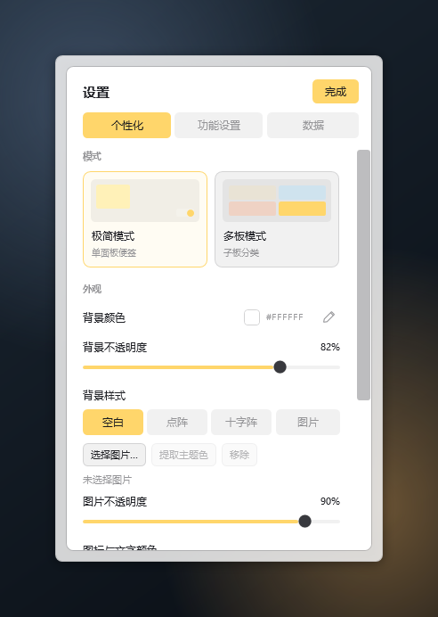
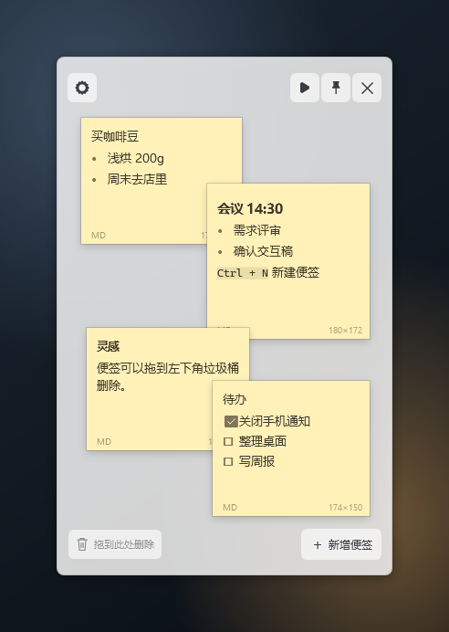

# CoTab · 桌面便签板

一个无边框、半透明、低占用的 Windows 桌面便签小工具。便签直接贴在桌面上，可拖动、可重叠、支持 Markdown，数据全部保存在本机。

## 界面预览






## 快速开始

1. 运行 `dist\CoTab\CoTab.exe`（当前发布的是 framework-dependent 版本，需要安装 [.NET 10 Desktop Runtime](https://dotnet.microsoft.com/download/dotnet/10.0)；也可以在该目录执行 `dotnet CoTab.dll`，或解压 `dist\CoTab-win-x64.zip` 后运行）。
2. 面板默认出现在主屏幕右侧，顶部可拖动；靠近或部分超出屏幕边缘时会自动贴边，并在空闲后收成一个固定大小的小标签。小标签尺寸不随面板宽度变化，并出现在面板原来的位置附近，而不是固定在屏幕边缘中点。
3. 收起和展开都有滑动动画：面板整体滑出屏幕边缘后，小标签再从同一位置伸出；点击小标签或右下角系统托盘图标即可展开。窗口本身不会显示任务栏图标，但系统托盘图标从启动起就一直保留，展开状态也可以从托盘把窗口重新叫到前台。

首次运行会在 `%LOCALAPPDATA%\CoTab\` 创建：

- `state.json`：所有设置和便签内容
- `images\`：自定义背景图副本
- `log.txt`：异常日志（仅在出错时写入）

## 界面与操作

| 位置 / 操作 | 功能 |
| --- | --- |
| 左上角齿轮 | 打开设置 |
| 右上角图钉 | 开关窗口置顶（深色表示开启，淡色表示关闭） |
| 右上角三角形 | 开关自动收起；箭头指向面板将要收起的屏幕边缘方向（深色开启，淡色关闭） |
| 右上角 × | 关闭并保存 |
| 右下角「+ 新增便签」 | 在面板中央创建一张空白便签 |
| 左下角垃圾桶 | 把便签拖到这里删除 |
| 左键单击便签 | 进入文字编辑；支持 Markdown |
| 左键按住拖动 | 在面板内移动便签，可覆盖其他便签 |
| 左键点击面板空白处 | 退出当前便签编辑 |
| 右键便签 | 便签颜色、字体颜色、纯文本 / Markdown 模式、红色「删除便签」 |
| 拖动便签右下角 | 调整单张便签大小 |
| 拖动面板边缘 / 四角 | 调整面板大小 |
| 拖动面板顶部空白处 | 移动面板；靠近屏幕边缘时自动吸附 |
| 点击收起标签 / 托盘图标 | 展开面板 |
| `Ctrl + N` | 新增便签 |
| `Ctrl + ,` | 打开设置 |
| `Esc` | 退出编辑 / 关闭设置 / 展开已收起的面板 |

新增便签默认是 184×184 的尖角正方形，默认淡黄色底、深棕色字，可在设置里修改默认颜色，也可单独改某一张便签。

## 设置项

- **外观**：面板背景颜色、背景不透明度（18%–100%）
- **背景样式**：空白、点阵、十字阵、自定义图片
  - 图片会复制到数据目录，可调图片不透明度
  - 「提取主题色」会从图片中提取一个适合作为前景文字的颜色，并同步到设置、关闭、新增便签三处图标/文字
- **图标与文字颜色**：分别自定义设置图标、关闭按钮、新增便签文字颜色
- **便签**：新建便签的默认底色和字体颜色
- **行为**：贴边自动收起、窗口置顶、开机自动启动、启用垃圾桶、删除前确认
  - 右上角的图钉和三角形也可以直接切换「窗口置顶」和「自动收起」
  - 收起后只显示一个固定大小的小标签；任务栏不显示图标，但系统托盘图标从启动到关闭一直存在。小标签会跟随面板原来的位置，收起/展开使用平滑滑动动画
- **数据**：打开数据文件夹

## 构建

需要 .NET 10 SDK（Windows）。

```powershell
dotnet build .\CoTab.csproj
dotnet run --project .\CoTab.csproj
```

发布为独立单文件（目标机器无需安装 .NET；首次发布需要联网还原 win-x64 运行时包）：

```powershell
dotnet publish .\CoTab.csproj -c Release -r win-x64 --self-contained true `
  -p:PublishSingleFile=true -p:IncludeNativeLibrariesForSelfExtract=true `
  -o .\dist\CoTab-win-x64
```

发布为轻量版（需要目标机器安装 .NET 10 Desktop Runtime）：

```powershell
dotnet publish .\CoTab.csproj -c Release -r win-x64 --self-contained false `
  -p:PublishSingleFile=true -o .\dist\CoTab-lite
```

## 说明

- 便签内容、颜色、大小、面板位置都会自动保存；关闭窗口时也会保存。
- 开机启动使用当前用户的 `HKCU\Software\Microsoft\Windows\CurrentVersion\Run`，不需要管理员权限。移动程序后重新打开应用，会自动修正启动路径。
- Markdown 中的链接目前只作展示（便签整体不接收点击），编辑状态下可正常复制粘贴。
- 本工具不联网、不上传任何内容。

## 仓库

<https://github.com/BAIJIXXX/CoTab>
