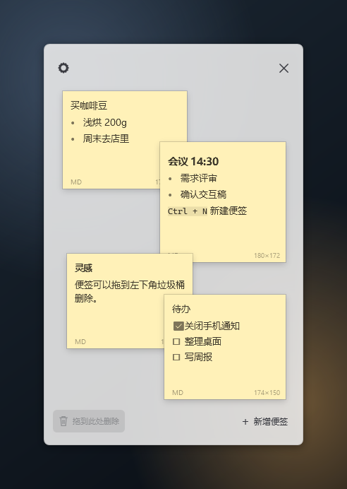
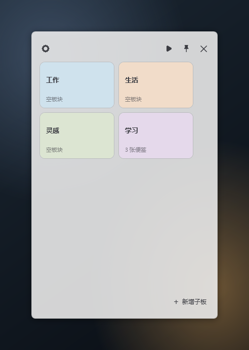
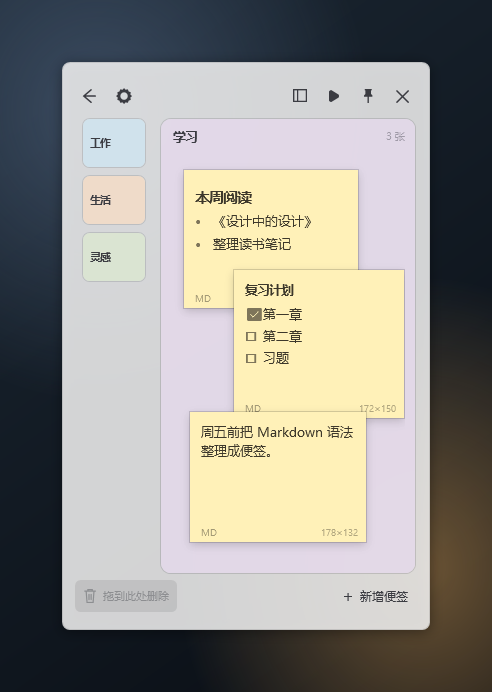
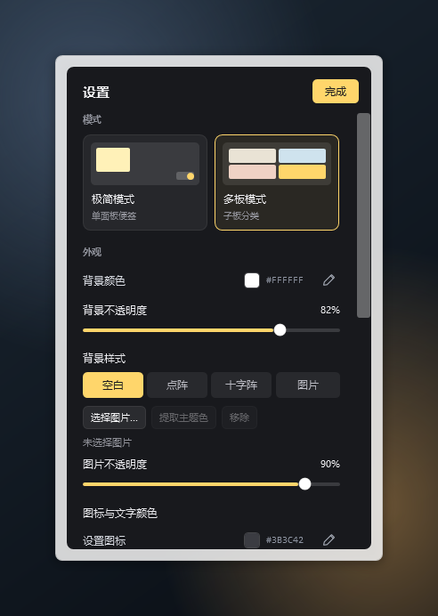
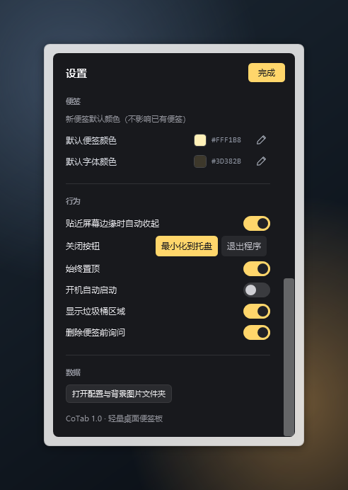
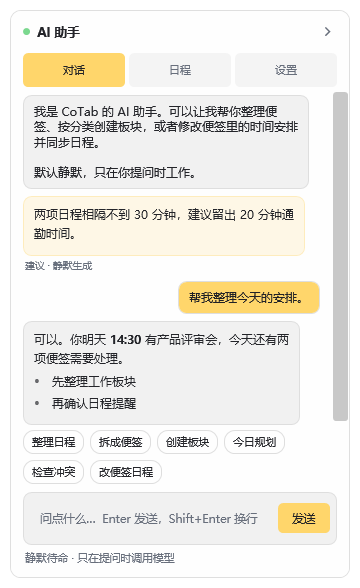
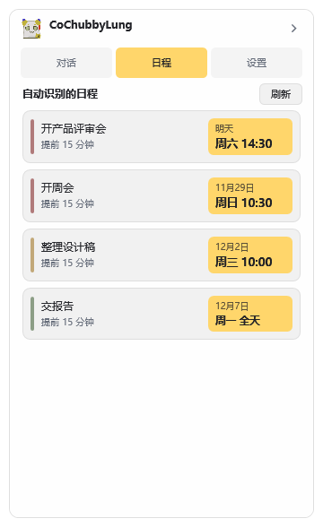
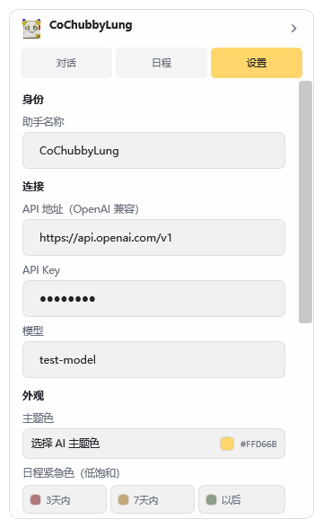
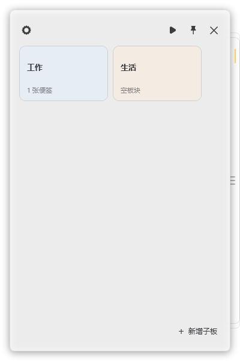

# CoTab · 桌面便签板

一个无边框、半透明、低占用的 Windows 桌面便签小工具。便签直接贴在桌面上，可拖动、可重叠、支持 Markdown，数据全部保存在本机。提供「极简模式」和可按分类管理便签的「多板模式」。

## 界面预览

















## 快速开始

1. 运行 `dist\CoTab\CoTab.exe`（当前发布的是 framework-dependent 版本，需要安装 [.NET 10 Desktop Runtime](https://dotnet.microsoft.com/download/dotnet/10.0)；也可以在该目录执行 `dotnet CoTab.dll`，或解压 `dist\CoTab-win-x64.zip` 后运行）。
2. 面板默认出现在主屏幕右侧，顶部可拖动；靠近或部分超出屏幕边缘时会自动贴边，并在空闲后收成一个固定大小的小标签。小标签尺寸不随面板宽度变化，并出现在面板原来的位置附近，而不是固定在屏幕边缘中点。
3. 收起和展开都有滑动动画：面板整体滑出屏幕边缘后，小标签再从同一位置伸出；点击小标签或右下角系统托盘图标即可展开。窗口本身不会显示任务栏图标，但系统托盘图标从启动起就一直保留，展开状态也可以从托盘把窗口重新叫到前台。点右上角 × 默认只最小化到托盘，不会结束进程；可在「设置 → 行为 → 关闭按钮」改成直接退出程序。

首次运行会在 `%LOCALAPPDATA%\CoTab\` 创建：

- `state.json`：所有设置和便签内容
- `images\`：自定义背景图副本
- `log.txt`：异常日志（仅在出错时写入）

## 界面与操作

| 位置 / 操作 | 功能 |
| --- | --- |
| 左上角齿轮 | 打开设置 |
| 左上角返回箭头 | 多板模式下从子板返回主页 |
| 右上角侧栏按钮 | 多板模式下显示 / 隐藏左侧子板栏 |
| 右上角图钉 | 开关窗口置顶（深色表示开启，淡色表示关闭） |
| 右上角三角形 | 开关自动收起；箭头指向面板将要收起的屏幕边缘方向（深色开启，淡色关闭） |
| 右上角 × | 按设置执行：默认最小化到系统托盘；也可改为直接退出程序 |
| 右下角「+ 新增便签」 | 在面板中央创建一张空白便签 |
| 左下角垃圾桶 | 把便签拖到这里删除 |
| 左键单击便签 | 进入文字编辑；支持 Markdown |
| 左键按住拖动 | 在面板内移动便签，可覆盖其他便签 |
| 左键点击面板空白处 | 退出当前便签编辑 |
| 右键便签 | 便签颜色、字体颜色、纯文本 / Markdown 模式、红色「删除便签」 |
| 拖动便签右下角 | 调整单张便签大小 |
| 拖动面板边缘 / 四角 | 调整面板大小 |
| 拖动面板顶部空白处 | 移动面板；靠近屏幕边缘时自动吸附 |
| 点击收起标签 / 托盘图标 | 展开面板；从托盘菜单可新建便签或退出程序 |
| `Ctrl + N` | 新增便签；多板主页新增子板 |
| `Ctrl + ,` | 打开设置 |
| 设置 → 行为 → AI 助手 | 开启/关闭可选 AI 助手，或重新打开 AI 小窗 |
| `Esc` | 退出编辑 / 关闭设置 / 返回多板主页 / 展开已收起的面板 |

新增便签默认是 184×184 的尖角正方形，默认淡黄色底、深棕色字，可在设置里修改默认颜色，也可单独改某一张便签。

## 多板模式

在「设置 → 模式」中可以在两种模式之间切换：

- **极简模式**：保持原来的单面板便签板，所有便签都在同一页。
- **多板模式**：用子板给便签分类。

多板模式的操作：

| 位置 / 操作 | 功能 |
| --- | --- |
| 右下角「+ 新增子板」 | 在主页新建一个分类板块 |
| 点击子板卡片 | 进入该子板 |
| 右键子板卡片 | 重命名、修改板块颜色、删除板块（删除后可点击提示撤销） |
| 子板内双击标题 | 重命名当前板块 |
| 子板左侧栏 | 快速切换其他板块；右上角侧栏按钮可显示 / 隐藏 |
| 子板内「+ 新增便签」 | 在板块内新建便签，操作与极简模式一致 |
| 左上角返回箭头 | 返回多板主页 |

板块默认自动排列，不会互相覆盖；板块较多时可以在主页用滚轮上下滚动。新板块默认使用比主板深一些的半透明颜色，也可以单独修改。便签、板块和当前模式都会自动保存。

进入子板时，选中的板块会从卡片位置放大到主区域，其余板块滑入左侧栏，便签从下往上淡入；返回主页时板块收缩，越过边界的便签会被裁切，形成自然的收拢效果。极简模式下新建、撤销恢复、启动恢复或切换模式时，便签同样从下往上淡入。动画使用缓入缓出，关闭动画可设置环境变量 `COTAB_DISABLE_ANIMATIONS=1`。

## AI 助手（可选）

AI 助手是默认关闭的可选功能，开启后会在主面板旁边打开一个竖向小窗，默认贴在主面板右侧。关闭小窗不会退出程序，也不会关闭 AI 提醒；需要再次打开时，到「设置 → 行为 → AI 助手」点「打开 AI 助手」。

首次使用需要在 AI 小窗的「设置」页填写：

- **API 地址**：默认 `https://api.openai.com/v1`，也兼容其他 OpenAI 格式接口；程序会自动补上 `/chat/completions`
- **API Key**：只保存在本机 `state.json` 中，不经过 CoTab 的服务器
- **模型**：默认 `gpt-4o-mini`；需要支持 OpenAI tools / function calling，AI 才能创建板块和便签
- **主题色**：默认 `#FFD66B`，用于 AI 窗口的分页、发送按钮、用户气泡和日程提醒强调色
- **系统提示词**：可选，会追加在内置提示词之后

AI 小窗的高度与主面板可见区域对齐，左右仅保留 4 DIP 间距，背景颜色/透明度跟随主面板设置；主面板换色或调整透明度后 AI 小窗会同步更新。

AI 助手具备以下能力：

- 用自然语言要求 AI 根据当前模式创建便签或子板。极简模式创建普通便签；多板模式会先查询现有板块，再按名称/ID 创建子板或在指定板块中创建便签
- 便签内容发生变化后，本地规则会识别「明天 14:30」「后天 9 点」「11月28日 下午3点」等中文/英文时间表达，转换成日程；提前提醒分钟数可在 AI 设置页修改
- 到时间前弹出置顶提醒，可以「稍后 10 分钟」或「知道了」
- 可选在识别到日程变化时，在对话里静默生成一条整理建议
- 除主动提问、到点提醒和可选的整理建议外，不会在后台调用模型；AI 小窗折叠后，主面板右侧会露出一叠“书页边缘”，点击即可重新展开

隐私说明：

- 便签板本身不联网；只有你在 AI 对话里主动发送内容，或点击「测试连接」时，才会把当前对话/状态摘要发给你配置的 API 地址
- 日程识别默认在本地完成，不会上传便签原文
- API Key 以明文保存在本机 `state.json`，请只在自己的电脑上使用






## 设置项

- **模式**：极简模式 / 多板模式，缩略图展示两种布局
- **外观**：面板背景颜色、背景不透明度（18%–100%）
- **背景样式**：空白、点阵、十字阵、自定义图片
  - 图片会复制到数据目录，可调图片不透明度
  - 「提取主题色」会从图片中提取一个适合作为前景文字的颜色，并同步到设置、关闭、新增便签三处图标/文字
- **图标与文字颜色**：分别自定义设置图标、关闭按钮、新增便签文字颜色
- **便签**：新建便签的默认底色和字体颜色
- **行为**：贴边自动收起、窗口置顶、开机自动启动、启用垃圾桶、删除前确认、关闭按钮行为、可选 AI 助手
  - 「关闭按钮」可选「最小化到托盘」（默认）或「退出程序」。选前者时点 × 只隐藏窗口，进程和托盘图标继续保留；需要彻底退出时用托盘右键菜单的「退出」
  - 右上角的图钉和三角形也可以直接切换「窗口置顶」和「自动收起」
  - 收起后只显示一个固定大小的小标签；任务栏不显示图标，但系统托盘图标从启动到关闭一直存在。小标签会跟随面板原来的位置，收起/展开使用平滑滑动动画
  - 如果托盘区没看到图标：Windows 11 默认会把新图标放进右下角的 `^` 溢出区，把它拖到任务栏即可固定；首次启动也会弹出一次提示。若仍找不到，请先在任务管理器结束旧的 `CoTab.exe` 进程再重新启动
  - 如果窗口正常但托盘里完全没有图标，通常是程序所在文件夹带有“低完整性”标签（部分沙箱/受限目录会这样），Windows 会禁止它向资源管理器注册托盘图标。把 `dist\CoTab` 复制到普通目录（例如 `%LOCALAPPDATA%\Programs\CoTab`）再运行；或对该目录执行 `icacls ".\dist\CoTab" /setintegritylevel "(OI)(CI)Medium" /T` 后重新启动程序
- **数据**：打开数据文件夹

## 构建

需要 .NET 10 SDK（Windows）。

```powershell
dotnet build .\CoTab.csproj
dotnet run --project .\CoTab.csproj
```

发布为独立单文件（目标机器无需安装 .NET；首次发布需要联网还原 win-x64 运行时包）：

```powershell
dotnet publish .\CoTab.csproj -c Release -r win-x64 --self-contained true `
  -p:PublishSingleFile=true -p:IncludeNativeLibrariesForSelfExtract=true `
  -o .\dist\CoTab-win-x64
```

发布为轻量版（需要目标机器安装 .NET 10 Desktop Runtime）：

```powershell
dotnet publish .\CoTab.csproj -c Release -r win-x64 --self-contained false `
  -p:PublishSingleFile=true -o .\dist\CoTab-lite
```

## 说明

- 便签内容、颜色、大小、面板位置都会自动保存；关闭窗口时也会保存。
- 开机启动使用当前用户的 `HKCU\Software\Microsoft\Windows\CurrentVersion\Run`，不需要管理员权限。移动程序后重新打开应用，会自动修正启动路径。
- Markdown 中的链接目前只作展示（便签整体不接收点击），编辑状态下可正常复制粘贴。
- 便签板本身不联网；AI 助手默认关闭，只有主动对话/测试连接时才会访问你配置的 OpenAI 兼容接口。

## 仓库

<https://github.com/BAIJIXXX/CoTab>
